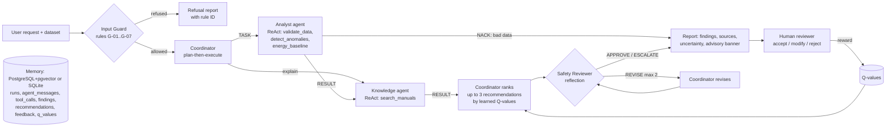

# System architecture and step-by-step method

**ITAI 2376 | Group 2 (14562)**
Group members: Mary Ann Mastri, Luiz Paludo, Cesar Antonio Noriega Martinez
Architecture, message protocol, database memory and safety rules: Luiz Paludo

## 1. Flow chart

## 2. Step-by-step method: how the agents run

| # | Step | What happens | Code |
|---|---|---|---|
| 1 | Input | The user types a request (and may give a CSV). A run ID is created; request and dataset are stored in `runs`. | `HVACSystem.run` |
| 2 | Screen | The Input Guard checks length, prompt injection, secrets, control commands, out-of-scope decisions, topic and file type/size. A refusal is logged with its rule ID and explained. | `agents/guard.py` |
| 3 | Plan | The Coordinator writes a JSON plan (maintenance, energy, both or explain). An LLM plan is accepted only if it matches the screened intent. | `node_plan` |
| 4 | Acknowledge and validate | The Coordinator sends a TASK. The Analyst sends ACK, then runs `validate_data`. A failure stops only that branch (NACK with reasons). | `protocol.py`, `AnalystAgent` |
| 5 | Analyse (ReAct) | Thought -> Action -> Observation loop: `detect_anomalies` and/or `energy_baseline`. An LLM action that breaks the rules (e.g. analyse before validate) is replaced by the rule. | `AnalystAgent` |
| 6 | Retrieve evidence | For findings of medium severity or higher, a TASK linked to the Analyst's RESULT (`depends_on`) goes to the Knowledge agent, which searches the manuals and returns passages with source and page, or NO_EVIDENCE. | `KnowledgeAgent` |
| 7 | Recommend | Up to 3 candidate actions per finding come from a reviewed library (the LLM never invents actions) and are ranked by learned Q-values with 10 % exploration. | `agents/ranker.py` |
| 8 | Review (reflection) | The Safety Reviewer checks every number against the tool outputs, comfort/safety limits and whether the evidence really supports the finding. APPROVE, REVISE (max 2 loops) or ESCALATE. | `SafetyReviewer` |
| 9 | Deliver | The report lists findings, cited sources, recommendations, the review decision, the ReAct trace, limits, model versions, latency, tokens and the advisory banner. A copy is saved in `reports/`. | `build_report` |
| 10 | Learn | The engineer accepts, modifies or rejects each recommendation -> reward -> `Q <- Q + 0.2 (r - Q)`. Reviewer safety violations also give -1. | `HVACSystem.feedback` |

## 3. Architecture components (course requirement)

- **Input processing:** Input Guard (rules) + intent classification; the Coordinator reads the intent and dataset.
- **Memory:** 7 tables (`memory.py`). PostgreSQL + pgvector when `DATABASE_URL` is set, SQLite otherwise. Run state is held in the LangGraph state.
- **Reasoning:** plan-then-execute (Coordinator), ReAct (Analyst, Knowledge), reflection (Safety Reviewer).
- **Output:** Markdown report with the banner *Advisory only: human approval required*.

## 4. Tools: when they are used, error handling, how the output is used

| Tool | When the agent uses it | Error handling / fallback | How the output is used |
|---|---|---|---|
| `validate_data` | First action on every dataset branch | Missing columns, bad timestamps, Fahrenheit, out-of-range % -> branch stops with NACK; no silent filling of missing values | Analyst continues only on PASS; reasons appear in the report |
| `detect_anomalies` | Maintenance branch, after validation passes | Autoencoder missing or failing -> Isolation Forest; both fail -> human review | Events of >= 1 h above tau become findings with severity and a rule-based fault hint; scores are not failure probabilities |
| `energy_baseline` | Energy branch, after validation passes | Under 90 days of history -> "no baseline" | Days > 15 % above the weather-aware baseline for 2+ days become leads, with CV(RMSE) and NMBE |
| `search_manuals` | Findings of medium severity or higher, or an explain question | Retry twice, then NO_EVIDENCE; score below MIN_SCORE -> NO_EVIDENCE; missing library -> NO_EVIDENCE with reason | Passages with source and page are attached to recommendations; the Reviewer checks that they mention the fault |
| LLM (Claude Haiku 5.5) | Plan wording, ReAct thoughts, search queries, summary, reviewer note | Timeout or bad JSON -> one repair retry -> template; response cache; token cap; temperature 0 | Text only. Numbers always come from code, and the Reviewer verifies them |

## 5. Message protocol

Every hand-off is a row in `agent_messages`: `TASK -> ACK -> RESULT` (or `NACK`, `ERROR`, `ESCALATION`).
The receiver ACKs before working. The Coordinator waits up to 60 s, retries twice, then uses the fallback.
Each TASK carries `depends_on` = the msg_id of the upstream RESULT, so the chain Analyst -> Knowledge -> Reviewer can be traced.

## 6. Safety and security

- **Input validation:** rules G-01..G-07 run before any LLM call.
- **Boundaries:** no equipment control, no staffing/regulatory decisions, actions only from the reviewed library, comfort/safety limits in `config.LIMITS`.
- **Fallbacks:** branch-level NACK, Isolation Forest fallback, NO_EVIDENCE, template text, ESCALATE for unknown limits or high-severity findings without evidence, and a clean stop with a saved report if the database fails.
- **Transparency:** every report shows sources, model and version, uncertainty, the ReAct trace and the review decision. Secrets live only in a gitignored `.env` file or Colab Secrets.
